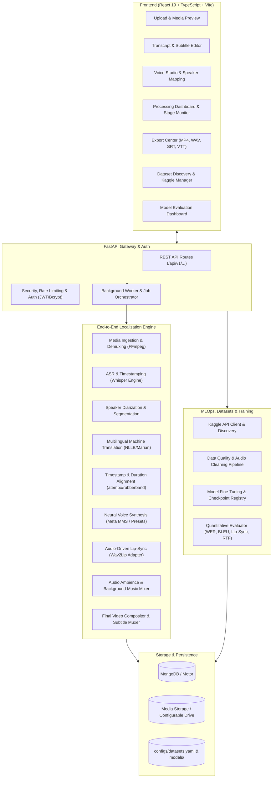

# ManaVoice AI — Architecture Specification

## 1. System Architecture Overview

ManaVoice AI is an end-to-end, ML-powered multilingual audio and video translation, neural voice synthesis, and lip-sync platform. It provides two complementary operational modes:
- **Mode A: Audio & Text Translation** (ASR, MT, TTS, Subtitles, Audio Dubbing).
- **Mode B: Complete Video Localization** (Demuxing, Diarization, Translation, Voice Cloning/Presets, Time-Stretch Alignment, Audio-Driven Lip-Sync, Ambience Mixing, Video Re-rendering).

---

## 2. Core Service Modules

### 2.1 Media Ingestion & Extraction (`services/media/`)
- **Supported Containers:** MP4, MOV, MKV, WebM, AVI, MP3, WAV, M4A, FLAC.
- **Audio Extraction:** High-fidelity 16 kHz mono 16-bit PCM extraction for ASR, 48 kHz stereo for dubbing/mixing.
- **Video Analysis:** Frame count, frame rate (FPS), resolution, duration, video codec detection via `ffprobe`.
- **Background Audio Demuxing:** Separate vocal frequencies from background instrumental/ambience tracks for natural dub mixing.

### 2.2 Automatic Speech Recognition (`services/asr/`)
- **Engine:** Whisper Architecture (supporting `openai/whisper-large-v3-turbo`, `faster-whisper`, and distilled models).
- **Features:** Automatic language identification, segment-level timestamps, confidence scoring, word-level boundaries.
- **Low-Resource & Indian Languages:** Native support for Hindi, Telugu, Tamil, Kannada, Malayalam, Bengali, Marathi, Gujarati, and English.

### 2.3 Speaker Diarization & Segmentation (`services/diarization/`)
- **Capabilities:** Multi-speaker turn detection, speaker clustering (`SPEAKER_00`, `SPEAKER_01`, etc.), overlap detection, manual speaker re-assignment.

### 2.4 Machine Translation (`services/translation/`)
- **Engines:** Multilingual Neural Machine Translation (NLLB-200, MarianMT, SeamlessM4T adapters with LibreTranslate & offline glossary fallbacks).
- **Features:** Contextual chunking, punctuation restoration, terminology preservation, Indian script Unicode normalization.

### 2.5 Text-to-Speech & Voice Studio (`services/tts/`)
- **Engines:** Meta MMS VITS models, licensed neutral preset voices, multi-speaker voice synthesis.
- **Controls:** Speaking rate adjustment (0.5x to 2.0x), pitch, prosody, silence insertion, loudness normalization (-16 LUFS broadcast standard).
- **Responsible Voice Policy:** Explicit consent verification for voice adaptation, prevention of unauthorized cloning.

### 2.6 Timing Alignment & Time-Stretching (`services/alignment/`)
- **Strategy:** Fits synthesized target speech into original dialogue timestamps.
- **Controlled Time-Stretching:** Uses high-quality phase-vocoder / FFmpeg `atempo` (clamped between 0.85x and 1.25x) to prevent "chipmunk" distortion, inserting subtle pauses at punctuation marks.

### 2.7 Lip-Sync & Face Processing (`services/lipsync/`)
- **Architecture:** Audio-driven Wav2Lip adapter with face detection and landmark tracking.
- **Graceful Fallback:** If no face is detected or lip-sync is disabled/unsupported on current hardware, the system renders a cleanly dubbed video with an explicit indicator in the processing log and export manifest.

### 2.8 Video Compositor & Rendering (`services/rendering/`)
- **FFmpeg Rendering:** Reassembles video frames, mixes dubbed dialogue with background music/ambience at user-defined volume ratios, embeds or sidecars SubRip (`.srt`) and WebVTT (`.vtt`) subtitles, and encodes the final H.264/AAC MP4.

---

## 3. MLOps, Kaggle Integration & Training

### 3.1 Kaggle API Client & Registry (`services/datasets/`)
- Authenticated discovery, search, file listing, and versioned download via Kaggle CLI / Python API.
- Storage-aware acquisition planner preventing out-of-disk crashes.
- Dataset registry maintained in `configs/datasets.yaml`.

### 3.2 Real ML Training & Fine-Tuning (`services/training/`)
- Fine-tuning scripts for translation (seq2seq), ASR (Whisper LoRA), and TTS.
- Execution profiles: Smoke test (10 samples), Small development run (100 samples), Full run.
- Checkpoint saving, validation metrics, early stopping, and model registry.

### 3.3 Quantitative Model Evaluation (`services/evaluation/`)
- **ASR:** Word Error Rate (WER) and Character Error Rate (CER).
- **Translation:** BLEU and chrF score calculators.
- **TTS:** Real-Time Factor (RTF) and synthesis latency.
- **Lip-Sync:** Audio-video sync offset and face-detection tracking consistency.
